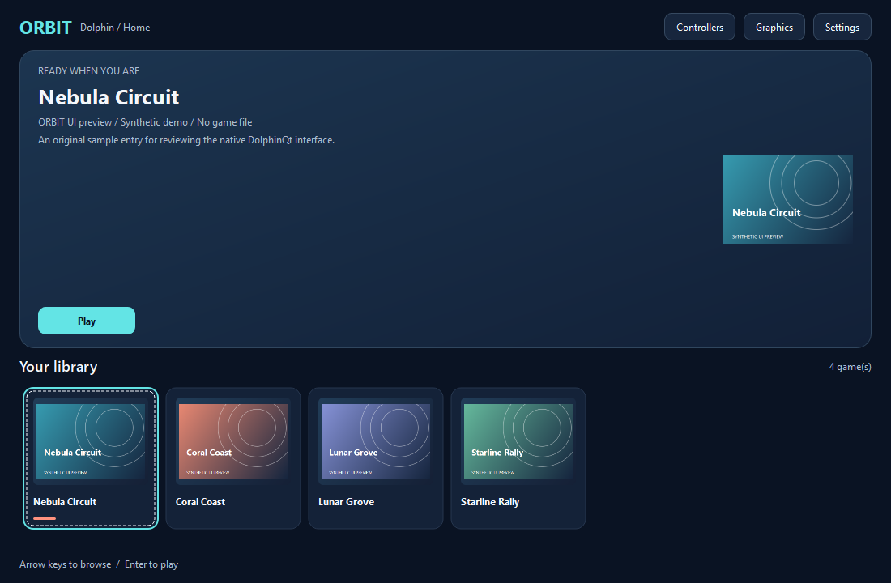

# Dolphin Orbit — interfaz nativa para Windows

Dolphin Orbit es un fork no oficial que utiliza la base de código completa de
**Dolphin Emulator**, creada y mantenida por **Dolphin Emulator Project y sus
autores y contribuidores**. El trabajo de este fork añade una interfaz propia
inspirada en la navegación de PS5 y Nintendo Switch dentro de DolphinQt,
implementada en C++/Qt Widgets.

- Repositorio de Orbit: [Manuucho27/dolphin-orbit](https://github.com/Manuucho27/dolphin-orbit).
- Descargas y versiones: [Releases de Orbit](https://github.com/Manuucho27/dolphin-orbit/releases).
- Repositorio original: [dolphin-emu/dolphin](https://github.com/dolphin-emu/dolphin).
- Base de partida: [e1d35f666cc35f6ead55d32ea2679df44d04da72](https://github.com/dolphin-emu/dolphin/commit/e1d35f666cc35f6ead55d32ea2679df44d04da72).
- [Guía de Orbit](README_ORBIT.md), [plan por fases](docs/ORBIT_PLAN.md) y
  [atribución y alcance del trabajo de IA](docs/ATTRIBUTION.md).

**La idea, el concepto y la dirección de Dolphin Orbit corresponden a
[Manuucho27](https://github.com/Manuucho27). Todo el trabajo técnico del rediseño Orbit
realizado en esta colaboración —investigación, implementación, integración,
scripts, pruebas y documentación— ha sido realizado por Codex, un modelo de
inteligencia artificial de OpenAI, con ayuda de sus subagentes.** Esta atribución
se refiere a las modificaciones de Orbit; el emulador y su código original son
obra de los autores y contribuidores de Dolphin y de sus dependencias.

Se mantienen los avisos de autoría, las licencias por archivo y la documentación
de Dolphin. La mayor parte de su código original y las nuevas modificaciones de
Orbit se distribuyen bajo **GPL versión 2 o posterior (GPLv2+)**; las dependencias
conservan sus propias licencias. Consulta [COPYING](COPYING) y
[LICENSES](LICENSES). Este fork es independiente del proyecto oficial.

**English:** Dolphin Orbit is an unofficial native DolphinQt interface fork,
built on the complete Dolphin Emulator codebase. Credit for the original emulator
belongs to the Dolphin Emulator Project, its authors and contributors.
[Manuucho27](https://github.com/Manuucho27) provided the Orbit idea, concept and
direction; Codex, an OpenAI AI model, and its
subagents carried out all Orbit technical work in this collaboration. Existing
copyright notices and licenses are preserved.



Vista de demostración del widget Qt real con entradas sintéticas, sin juegos
incluidos. La captura no corresponde a una sesión de emulación.

---

The original Dolphin README follows in full.

# Dolphin - A GameCube and Wii Emulator

[Homepage](https://dolphin-emu.org/) | [Project Site](https://github.com/dolphin-emu/dolphin) | [Buildbot](https://dolphin.ci/) | [Forums](https://forums.dolphin-emu.org/) | [Wiki](https://wiki.dolphin-emu.org/) | [GitHub Wiki](https://github.com/dolphin-emu/dolphin/wiki) | [Issue Tracker](https://bugs.dolphin-emu.org/projects/emulator/issues) | [Coding Style](https://github.com/dolphin-emu/dolphin/blob/master/Contributing.md) | [Transifex Page](https://app.transifex.com/dolphinemu/dolphin-emu/dashboard/) | [Analytics](https://mon.dolphin-emu.org/)

Dolphin is an emulator for running GameCube and Wii games on Windows,
Linux, macOS, and recent Android devices. It's licensed under the terms
of the GNU General Public License, version 2 or later (GPLv2+).

Please read the [FAQ](https://dolphin-emu.org/docs/faq/) before using Dolphin.

## System Requirements

### Desktop

* OS
    * Windows (10 1903 or higher).
    * Linux.
    * macOS (11.0 Big Sur or higher).
    * Unix-like systems other than Linux are not officially supported but might work.
* Processor
    * A CPU with SSE2 support.
    * A modern CPU (3 GHz and Dual Core, not older than 2008) is highly recommended.
* Graphics
    * A reasonably modern graphics card (Direct3D 11.1 / OpenGL 3.3).
    * A graphics card that supports Direct3D 11.1 / OpenGL 4.4 is recommended.

### Android

* OS
    * Android (7.0 Nougat or higher).
* Processor
    * A processor with support for 64-bit applications (either ARMv8 or x86-64).
* Graphics
    * A graphics processor that supports OpenGL ES 3.0 or higher. Performance varies heavily with [driver quality](https://dolphin-emu.org/blog/2013/09/26/dolphin-emulator-and-opengl-drivers-hall-fameshame/).
    * A graphics processor that supports standard desktop OpenGL features is recommended for best performance.

Dolphin can only be installed on devices that satisfy the above requirements. Attempting to install on an unsupported device will fail and display an error message.

## Building

You may find building instructions on the appropriate wiki page for your operating system:

* [Windows](https://github.com/dolphin-emu/dolphin/wiki/Building-for-Windows)
* [Linux](https://github.com/dolphin-emu/dolphin/wiki/Building-for-Linux)
* [macOS](https://github.com/dolphin-emu/dolphin/wiki/Building-for-macOS)
* [Android](#android-specific-instructions) <!-- TODO: Create a "Building for Android" wiki page and link it here -->
* [OpenBSD](https://github.com/dolphin-emu/dolphin/wiki/Building-for-OpenBSD) (unsupported)

Before building, make sure to pull all submodules:

```sh
git submodule update --init --recursive
```

### Android-specific instructions

These instructions assume familiarity with Android development. If you do not have an
Android dev environment set up, see [AndroidSetup.md](AndroidSetup.md).

If using Android Studio, import the Gradle project located in `./Source/Android`.

Android apps are compiled using a build system called Gradle. Dolphin's native component,
however, is compiled using CMake. The Gradle script will attempt to run a CMake build
automatically while building the Java code.

## Uninstalling

On Windows, simply remove the extracted directory, unless it was installed with the NSIS installer,
in which case you can uninstall Dolphin like any other Windows application.

Linux users can run `cat install_manifest.txt | xargs -d '\n' rm` as root from the build directory
to uninstall Dolphin from their system.

macOS users can simply delete Dolphin.app to uninstall it.

Additionally, you'll want to remove the global user directory if you don't plan on reinstalling Dolphin.

## Command Line Usage

```
Usage: Dolphin.exe [options]... [FILE]...

Options:
  --version             show program's version number and exit
  -h, --help            show this help message and exit
  -u USER, --user=USER  User folder path
  -m MOVIE, --movie=MOVIE
                        Play a movie file
  -e <file>, --exec=<file>
                        Load the specified file
  -n <16-character ASCII title ID>, --nand_title=<16-character ASCII title ID>
                        Launch a NAND title
  -C <System>.<Section>.<Key>=<Value>, --config=<System>.<Section>.<Key>=<Value>
                        Set a configuration option
  -s <file>, --save_state=<file>
                        Load the initial save state
  -d, --debugger        Show the debugger pane and additional View menu options
  -l, --logger          Open the logger
  -b, --batch           Run Dolphin without the user interface (Requires
                        --exec or --nand-title)
  -c, --confirm         Set Confirm on Stop
  -v VIDEO_BACKEND, --video_backend=VIDEO_BACKEND
                        Specify a video backend
  -a AUDIO_EMULATION, --audio_emulation=AUDIO_EMULATION
                        Choose audio emulation from [HLE|LLE]
```

Available DSP emulation engines are HLE (High Level Emulation) and
LLE (Low Level Emulation). HLE is faster but less accurate whereas
LLE is slower but close to perfect. Note that LLE has two submodes (Interpreter and Recompiler)
but they cannot be selected from the command line.

Available video backends are "D3D" and "D3D12" (they are only available on Windows), "OGL", and "Vulkan".
There's also "Null", which will not render anything, and
"Software Renderer", which uses the CPU for rendering and
is intended for debugging purposes only.

## DolphinTool Usage
```
usage: dolphin-tool COMMAND -h

commands supported: [convert, verify, header, extract]
```

```
Usage: convert [options]... [FILE]...

Options:
  -h, --help            show this help message and exit
  -u USER, --user=USER  User folder path, required for temporary processing
                        files. Will be automatically created if this option is
                        not set.
  -i FILE, --input=FILE
                        Path to disc image FILE.
  -o FILE, --output=FILE
                        Path to the destination FILE.
  -f rvz|iso|gcz|wia, --format=rvz|iso|gcz|wia
                        Container format to use. Default is RVZ.
  -s, --scrub           Scrub junk data as part of conversion.
  -b BLOCK_SIZE, --block_size=BLOCK_SIZE
                        Block size for GCZ/WIA/RVZ formats, as an integer.
                        Suggested value for RVZ: 131072 (128 KiB)
  -c none|zstd|bzip2|lzma|lzma2, --compression=none|zstd|bzip2|lzma|lzma2
                        Compression method to use when converting to WIA/RVZ.
                        Suggested value for RVZ: zstd
  -l COMPRESSION_LEVEL, --compression_level=COMPRESSION_LEVEL
                        Level of compression for the selected method. Ignored
                        if 'none'. Suggested value for zstd: 5
```

```
Usage: verify [options]...

Options:
  -h, --help            show this help message and exit
  -u USER, --user=USER  User folder path, required for temporary processing
                        files. Will be automatically created if this option is
                        not set.
  -i FILE, --input=FILE
                        Path to input file.
  -a crc32|md5|sha1|rchash, --algorithm=crc32|md5|sha1|rchash
                        Optional. Compute and print the digest using the
                        selected algorithm, then exit.
```

```
Usage: header [options]...

Options:
  -h, --help            show this help message and exit
  -i FILE, --input=FILE
                        Path to disc image FILE.
  -b, --block_size      Optional. Print the block size of GCZ/WIA/RVZ formats,
then exit.
  -c, --compression     Optional. Print the compression method of GCZ/WIA/RVZ
                        formats, then exit.
  -l, --compression_level
                        Optional. Print the level of compression for WIA/RVZ
                        formats, then exit.
```

```
Usage: extract [options]...

Options:
  -h, --help            show this help message and exit
  -i FILE, --input=FILE
                        Path to disc image FILE.
  -o FOLDER, --output=FOLDER
                        Path to the destination FOLDER.
  -p PARTITION, --partition=PARTITION
                        Which specific partition you want to extract.
  -s SINGLE, --single=SINGLE
                        Which specific file/directory you want to extract.
  -l, --list            List all files in volume/partition. Will print the
                        directory/file specified with --single if defined.
  -q, --quiet           Mute all messages except for errors.
  -g, --gameonly        Only extracts the DATA partition.
```
